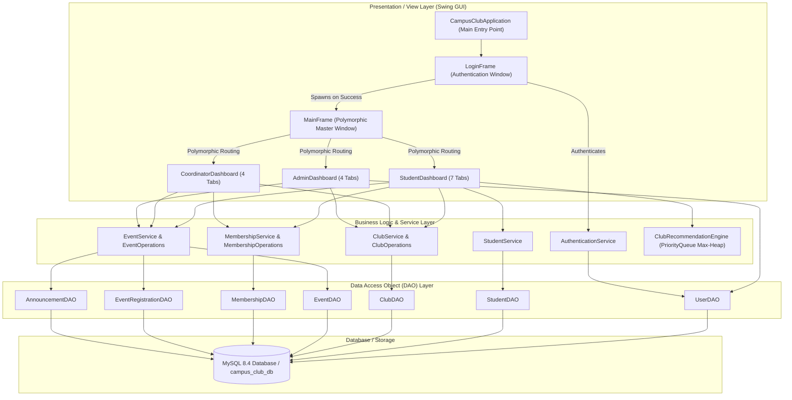
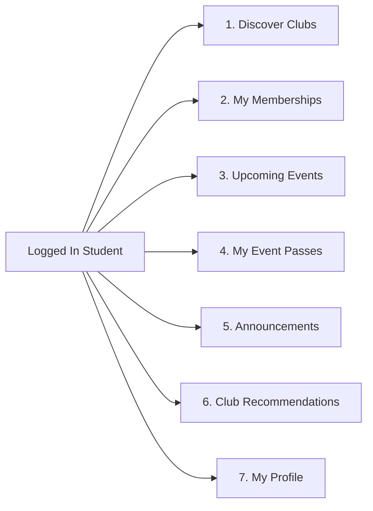

# Java Swing GUI Documentation & Interface Architecture
**Campus Club Management System** — *College Java Desktop Application*

---

## 1. GUI Overview & Architectural Principles

The Campus Club Management System delivers a desktop user interface built entirely with **pure Java Swing (JDK 17+)**. It adheres strictly to the **MVC (Model-View-Controller) / Layered Architecture**:

### Key GUI Architectural Guarantees:
1. **Zero SQL in GUI**: No SQL queries, prepared statements, or database connection strings exist inside any GUI class. All data interactions flow through the Service layer.
2. **Polymorphic Dashboard Loading**: Upon login, `MainFrame` reads the authenticated user's role (`STUDENT`, `COORDINATOR`, or `ADMIN`) and dynamically mounts the appropriate subclass dashboard.
3. **Safe Exception Boundaries**: Checked business exceptions (`InvalidLoginException`, `DuplicateMembershipException`, `ClubNotFoundException`, `EventRegistrationException`) and runtime `DatabaseOperationException` are caught at the UI boundary and rendered as user-friendly `JOptionPane` dialogs.
4. **Interactive Action Dialogs**: Critical actions (leaving clubs, cancelling event registrations, approving/rejecting applications, deleting events, logging out) require explicit user confirmation.

---

## 2. Design System & UI Theme (`UITheme.java`)

All graphical elements follow a unified, modern corporate palette:

| Color Token | Hex / RGB Code | UI Usage |
| :--- | :--- | :--- |
| `PRIMARY_NAVY` | `#192A56` / `rgb(25, 42, 86)` | Master top navigation bar, frame header branding |
| `PRIMARY_BLUE` | `#2563EB` / `rgb(37, 99, 235)` | Primary call-to-actions, Submit, Filter, Apply |
| `ACCENT_EMERALD` | `#10B981` / `rgb(16, 185, 129)` | Success indicators, Event registration, Approval |
| `DANGER_RED` | `#EF4444` / `rgb(239, 68, 68)` | Danger actions, Logout, Rejections, Deletions |
| `WARNING_AMBER` | `#F59E0B` / `rgb(245, 158, 11)` | Pending statuses, capacity alerts |
| `PURPLE_ACCENT` | `#7C3AED` / `rgb(124, 58, 237)` | Smart recommendation badge, AI scoring |
| `BG_LIGHT` | `#F8FAFC` / `rgb(248, 250, 252)` | Window background canvas |
| `CARD_BG` | `#FFFFFF` / `rgb(255, 255, 255)` | Container cards, tab content panels |
| `BORDER_COLOR` | `#E2E8F0` / `rgb(226, 232, 240)` | Card outlines, table grid lines |

### Typography (`Segoe UI` hierarchy):
- **Page Title**: `Segoe UI Bold 20pt`
- **Section Subtitle**: `Segoe UI Bold 15pt`
- **Form / Header**: `Segoe UI Bold 13pt`
- **Body / Table**: `Segoe UI Plain 13pt`
- **Metric Big Value**: `Segoe UI Bold 24pt`
- **Helper / Footnote**: `Segoe UI Plain 11pt`

---

## 3. Screen-by-Screen Layouts & Workflows

### 3.1. Login Portal (`LoginFrame.java`)
- **Branding Header**: Title banner and application subtitle.
- **Form Card**:
  - `Username` text field.
  - `Password` masked password field (`JPasswordField`).
  - **Quick Demo Credentials Hint Box** displaying test accounts (`student1 / pass123`, `coord_coding / pass123`, `admin / admin123`).
- **Actions**:
  - `Sign In` (Primary button, Default button on `<Enter>`).
  - `Clear` (Resets input fields).
  - `Exit` (`System.exit(0)`).
- **Status Area**: Inline live status feedback (authenticating, invalid credentials, database offline).

---

### 3.2. Master Application Frame (`MainFrame.java`)
- **Top Header Bar**:
  - Left: Application icon and title banner (`Campus Club Management System`).
  - Right: Logged-in user badge (`👤 Alex Turner [Student]`) and `Logout` button.
- **Logout Flow**: Prompts `JOptionPane.showConfirmDialog`; on confirmation, closes the main window and launches `LoginFrame`.
- **Dynamic Content**: Renders `StudentDashboard`, `CoordinatorDashboard`, or `AdminDashboard` using polymorphism.

---

### 3.3. Student Dashboard (`StudentDashboard.java`)

#### Top Metric Cards:
1. **My Clubs**: Count of approved/pending memberships.
2. **My Events**: Count of active event passes.
3. **Campus Events**: Total available upcoming schedules.
4. **Smart Matches**: Recommended clubs count ready for application.

#### Tabs and Functionalities:
- **Tab 1: Discover Clubs**:
  - Search bar + Category filter dropdown (`All Categories`, `Technical`, `Cultural`, `Sports`, `Social`, `Academic`, `Literary`).
  - JTable listing Club ID, Name, Category, Description, Coordinator, Active Members.
  - `Join Selected Club` action with confirmation dialog and duplicate prevention.
- **Tab 2: My Memberships**:
  - JTable listing Membership ID, Club Name, Category, Joined Date, Role, Status (`APPROVED`, `PENDING`, `REJECTED`).
  - `Leave / Withdraw Membership` button with confirmation.
- **Tab 3: Upcoming Events**:
  - Keyword search on event name, venue, or club name.
  - JTable with Event ID, Club, Title, Date & Time, Venue, Capacity, Registered Count.
  - `Register for Selected Event` button with validation for capacity and registration deadlines.
- **Tab 4: My Event Passes**:
  - JTable with Registration ID, Event Title, Club Name, Event Date, Venue, Registered At, Status.
  - `Cancel Registration` button with confirmation.
- **Tab 5: Announcements**:
  - Table of broadcasts from student's clubs and campus announcements with priority level tags (`HIGH`, `MEDIUM`, `LOW`).
- **Tab 6: Smart Club Recommendations**:
  - Displays ranked recommendations from `ClubRecommendationEngine` (Max-Heap scoring).
  - Shows Match Score and explainable reason tags (e.g. `Shared Interest: AI (+40)`, `Department Match: CSE (+50)`).
  - `Apply to Selected Recommendation` button directly applies without having to switch tabs.
- **Tab 7: My Profile & Interests**:
  - View USN, Full Name, Department, Semester, Email.
  - Edit Phone Number and Interests keywords.
  - `Save Profile Changes` updates database and dynamically recomputes smart recommendations.

---

### 3.4. Club Coordinator Dashboard (`CoordinatorDashboard.java`)

#### Top Metric Cards:
1. **Managed Club**: Assigned Club Name & Category.
2. **Total Members**: Count of approved club members.
3. **Pending Requests**: Count of membership applications requiring decision.
4. **Club Events**: Count of scheduled club events.

#### Tabs and Functionalities:
- **Tab 1: Club Overview & Settings**:
  - Read-only details: Club Name, Category, Status, Established Date.
  - Editable Description text area with `Update Club Description` button.
- **Tab 2: Membership Requests**:
  - Filter by status (`All Statuses`, `PENDING`, `APPROVED`, `REJECTED`).
  - JTable: Membership ID, Student ID, Student Name, USN, Department, Applied Date, Status.
  - `Approve Request` and `Reject Request` buttons with confirmation dialogs.
- **Tab 3: Manage Events & Rosters**:
  - JTable: Event ID, Title, Date & Time, Location, Capacity, Registrations, Status.
  - `Create New Event` dialog modal: Title, Description, Venue, Capacity, Date/Time picker (`yyyy-MM-dd HH:mm`).
  - `View Attendee Roster` modal table displaying registered student names, emails, and registration timestamps.
  - `Delete Event` button with confirmation.
- **Tab 4: Broadcast Announcements**:
  - Create Broadcast Form: Title, Message, Priority Level (`HIGH`, `MEDIUM`, `LOW`).
  - Broadcast History Table showing all past club announcements.

---

### 3.5. System Administrator Dashboard (`AdminDashboard.java`)

#### Top Metric Cards:
1. **Total Users**: All registered students, coordinators, and administrators.
2. **Campus Clubs**: Total registered clubs.
3. **Active Clubs**: Clubs active and open for membership.
4. **Campus Events**: All scheduled events campus-wide.

#### Tabs and Functionalities:
- **Tab 1: Manage Clubs**:
  - Search by keyword and Filter by status (`ACTIVE`, `INACTIVE`).
  - JTable: Club ID, Name, Category, Coordinator, Status, Member Count, Established Date.
  - `Register New Club` modal dialog (Name, Category, Description, Coordinator ID).
  - `Toggle Status (Active/Inactive)` button with confirmation.
  - `Delete Club` button with cascading safety warning.
- **Tab 2: User Registry**:
  - Role Filter dropdown (`All Roles`, `STUDENT`, `COORDINATOR`, `ADMIN`) and search bar.
  - JTable: User ID, Username, Full Name, Email, Role, Phone, Account Created.
- **Tab 3: Campus Events Overview**:
  - JTable of all events across all campus clubs with registration metrics and status.
  - `Delete / Cancel Event` button.
- **Tab 4: All Announcements**:
  - System-wide view of all published broadcasts across clubs.

---

## 4. Verification and Headless-Safe Testing

The GUI layer is tested through `GUIIntegrationTest.java` utilizing JUnit 5:
- Validates `UITheme` colors, button builders, card creators, and table stylers.
- Validates `DashboardCard` live metric update operations.
- Validates `LoginFrame` field initializations and credential validation.
- Validates `MainFrame` polymorphic dashboard creation for `Student`, `ClubCoordinator`, and `Admin`.
- Validates complete tab and table model initializations across all role dashboards.
- Fully compatible with headless CI environments (`java.awt.headless=true`).
